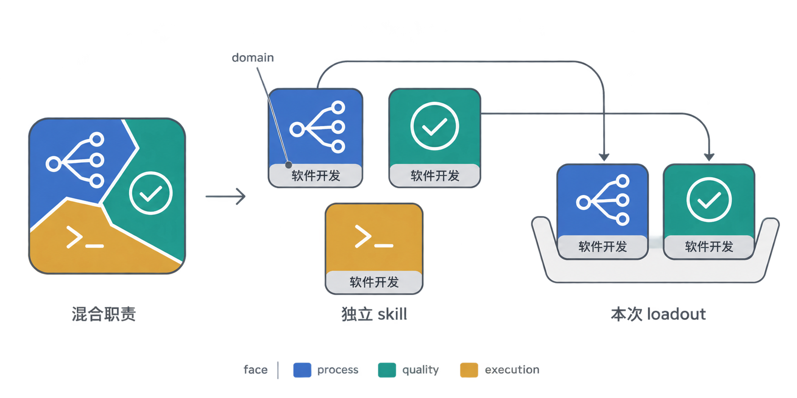
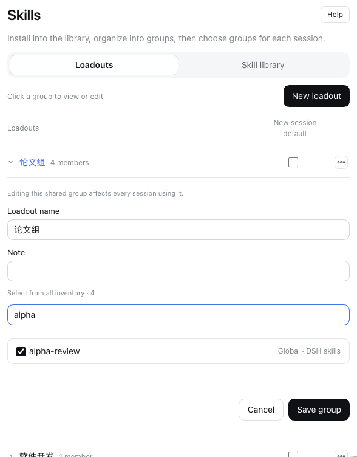
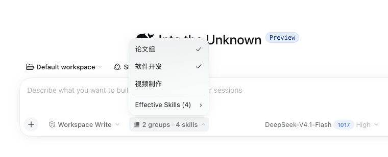

<h1 align="center">skill-loadout</h1>

<p align="center"><b>把混在一起的技能职责拆开，再按任务自由组合。</b></p>

<p align="center">
  <a href="#核心思想">核心思想</a> ·
  <a href="#dsh-插件">DSH 插件</a> ·
  <a href="#五份可独立使用的-skill">五份 skill</a> ·
  <a href="#安装-skill">安装 skill</a>
</p>

## 核心思想

一份“大而全”的 skill，常常把流程、质量标准、工具操作混在一起。想只换其中一种做法，却不得不接受其余全部；多装几份，又容易让两份指令争着定义同一件事。

**先按职责解耦，让每份 skill 只承担一个主面（face）；再用 domain 标记任务领域。使用时，挑选需要的几份组成 loadout。**



### face：它主要回答哪类问题？

| 主面 | 回答的问题 | 例子 |
|---|---|---|
| `process` 流程 | 何时做、谁决定、怎么交接？ | 发布流程、变更与授权 |
| `quality` 质量 | 怎样算合格、怎样做得更好？ | 代码质量标准、写作判断 |
| `execution` 执行 | 用什么工具、跑什么命令、产物在哪？ | 工具操作、安装与校验 |

**一份 skill 只标一个主面，不是每份 skill 都包含三个面。** 按职责决定是否拆分，不是把任何 skill 机械地拆成三份；一次任务也不必凑齐三面。

### domain：它服务哪个任务领域？

`domain` 是最接近这项任务的领域，例如“软件开发”“文档”“skills”。它和 face 是两个不同维度：**face 管哪类问题，domain 管哪个领域**，不是第四个面。

例如，发布流程、代码质量、工具操作可以同属“软件开发”，却分别承担三个不同的主面；给软件仓库写 README 的 skill，任务领域则是“文档”。领域名用于介绍与归堆，不是本插件要求的必填配置。

### loadout：这次任务选哪些 skill？

skill 之间不相互引用、不要求彼此存在。**组合由使用者决定，而不是靠 skill 之间的依赖关系。** 这样才能单独使用、替换或重新搭配其中任意一份。

这次任务选用的一组 skill 就是一个 **loadout（配装）**。下面的 DSH 插件让你把常用组合保存成命名编组，再在各个会话里按需选用；编组不要求成员带有 face 或 domain 标签。

## DSH 插件

### 编一次组，每个会话按需选用

**dsh-loadout 是 DeepSeek Harness（DSH）插件：把多个 skill 保存为命名编组，并在每个 session 中手动启用或关闭这些组。**

- **设置中编组**：从全局技能库选择成员，保存为可复用的组。
- **聊天框选用**：为当前会话勾选零个、一个或多个组，不同会话独立选择。
- **看清生效名单**：浏览、搜索“已生效 Skills”；多个组包含同一技能时只生效一次。

**① 在设置中编辑编组成员**



**② 在聊天框为当前会话启用或关闭编组**



全局技能按组选用；当前工作目录的项目技能默认可用，可在当前会话中单独关闭。设置中的默认勾选只决定**新会话的初始选择**，不会覆盖已有会话。关闭组不会抹掉已经进入聊天历史的内容。

安装到 DSH 的 web profile：

```sh
dsh plugin --profile web add "https://github.com/vlln/skill-loadout.git#path:/plugin"
```

插件可以独立使用，不必先安装下面五份 skill。完整操作、兼容性与限制见 [插件说明](plugin/README.md)。

## 五份可独立使用的 skill

插件帮你**选用 skill**；这五份 skill 帮你**设计、编写和改进 skill**。它们是这套解耦方法的实际应用，各自可以单独安装，不互相依赖。

| skill | face | domain | 介绍 |
|---|---|---|---|
| [skill-atlas](skills/skill-atlas/SKILL.md) | `quality` | skills | 判断一份 skill 该管什么、两份是否重叠、要不要拆 |
| [skill-writing](skills/skill-writing/SKILL.md) | `quality` | skills | 判断一份 skill 写成什么样算合格 |
| [skill-making](skills/skill-making/SKILL.md) | `process` | skills | 从决定做到发布的流程与检查点 |
| [skit](skills/skit/SKILL.md) | `execution` | skills | 安装、检查、导出，以及装好后怎么验 |
| [improvement-loop](skills/improvement-loop/SKILL.md) | `process` | skills | 对比新旧版本，判断一次改进是否有效 |

面对一堆待整理的材料，可以先定位任务边界、再写内容、走制作流程、安装验证，后续迭代时比较新旧版本。按实际需要选用，不必一次加载五份。

## 安装 skill

用 skit 按需安装：

```sh
skit install vlln/skill-loadout/skills/skill-atlas vlln/skill-loadout/skills/skill-writing      # 定位与合格线
skit install vlln/skill-loadout/skills/skill-making vlln/skill-loadout/skills/improvement-loop  # 流程与改进回路
skit install vlln/skill-loadout/skills/skit                                                   # 安装与校验
skit check
```

也可以用 npx skills：

```sh
npx skills add vlln/skill-loadout --skill skill-writing    # 换成别的名字就装别的
```

没有安装工具时，可以把下面这段发给 agent：

```text
Run `npx skills use "vlln/skill-loadout@skill-writing"` and follow the generated skill instructions now. Read its complete output, redirecting it to a temporary file first if necessary. Resolve relative paths from the supporting-files directory it provides.
```

本地修改时，克隆仓库后用 `skit install ./skills/<名>` 安装。安装完成后，可用 `skit list` 查看、`skit check` 检查。

## 继续了解

这是一套组织内容与组合使用的方法，不是强制分类或自动校验系统。完整论证、证据强度和可被推翻的预测分开记录：

| 文档 | 内容 |
|---|---|
| [内容坐标：面](THEORY.md) | 三个主面的定义、独立与组合的原则 |
| [证据与状态](docs/status.md) | 每条结论有多少证据，哪些预测还没测过 |
| [制作方法](docs/method.md) | 从选题到做出 loadout 的过程 |
| [插件说明](plugin/README.md) | DSH 中的技能库、编组和会话选用 |

[sw-dev-loadout](https://github.com/vlln/sw-dev-loadout) 是软件开发领域的应用案例，也是这套方法的实验样本。

## 许可

仓库主体采用 [MIT](LICENSE)；DSH 插件的来源与 Apache-2.0 许可见[插件许可说明](plugin/README.md#致谢与许可)。
