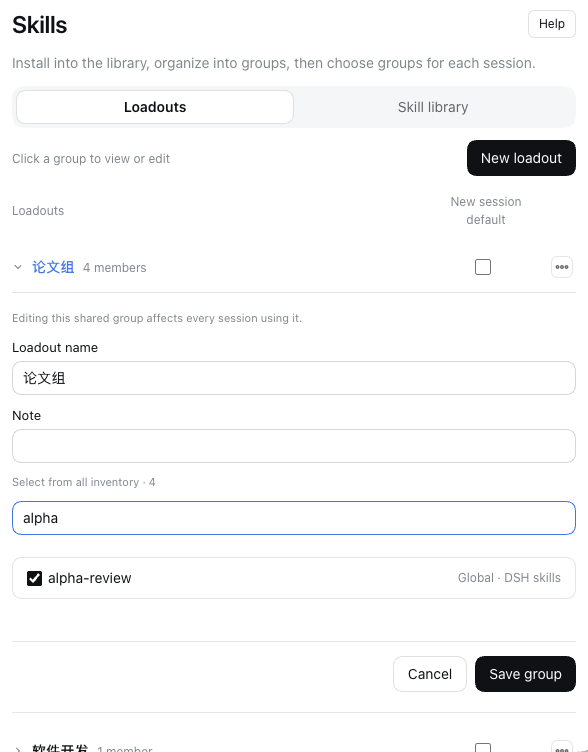
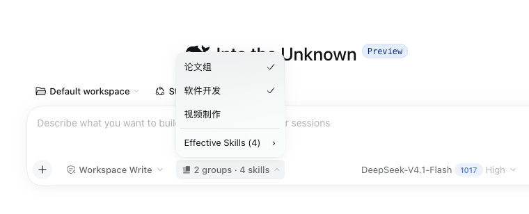

<h1 align="center">dsh-loadout</h1>

<p align="center"><b>把多个 skill 编成组，在每个 DSH 会话中手动启用或关闭。</b></p>

<p align="center">
  <a href="#安装">安装</a> ·
  <a href="#用起来什么样">用起来什么样</a> ·
  <a href="#兼容性">兼容性</a>
</p>

<p align="center">
  <a href="#致谢与许可"></a>
  <a href="https://github.com/vlln/skill-loadout"></a>
</p>

<br>

## 它是什么

**dsh-loadout 是 DeepSeek Harness（DSH）的技能编组插件。** 从全局技能库挑选多个 skill，保存为命名编组；在聊天框为当前 session 手动勾选或取消这些组，不必逐个切换技能。

- **编组可复用**：在设置中创建、编辑成员，编组只保存引用，不搬动技能文件。
- **会话独立选用**：每个会话可以启用零个、一个或多个组，互不覆盖选择。
- **生效名单可见**：搜索、预览“已生效 Skills”；重叠技能只提供一次。取消一个组，其他已选组需要的技能继续可用。

技能库负责库存与安装，编组负责成员配置，会话负责选用。项目技能不参与编组：它们随当前工作目录默认可用，可在聊天框单独关闭。插件不要求技能带有 `face` 或 `domain` 标签，也不要求安装本仓库的五份 skill。

## 为什么需要它

技能装多了以后，每个任务真正需要的只是其中几张。逐个开关是体力活，而且"上次那组到底有哪几张"没人记得。loadout 把这组固化成一个有名的东西：编一次，以后一个动作切换。

与相邻能力的区别：插件管理器（Plugins 页）管的是插件包装没装，loadout 管的是已装技能在当前任务里生不生效；"分类"是浏览时的组织位面，loadout 是执行时的编组位面。

两件结构性的事：日常面对的不再是技能清单而是几个编组（管理复杂度随任务类型数增长，不随技能数）；装与用被拆开，装只是入库，囤积不再有上下文代价。展开见 [docs/why-loadout.md](docs/why-loadout.md)。

## 安装

插件在 [vlln/skill-loadout](https://github.com/vlln/skill-loadout) 仓库的 `plugin/` 子目录，产物已入库，git 源一行装：

```sh
dsh plugin --profile web add "https://github.com/vlln/skill-loadout.git#path:/plugin"
```

装好后侧栏出现「Loadout」入口。

## 用起来什么样

### 1. 在设置中编好一组技能

点击组名，在展开的编辑器中搜索、勾选成员，再保存。默认列的勾选只设置**新会话的初始编组**，不改变已有会话的选择。



### 2. 在当前会话启用或关闭编组

打开聊天框的 Loadout 菜单，勾选这次任务需要的几个组；取消勾选即可关闭该组的贡献。“已生效 Skills”可以搜索、按组浏览并打开只读预览。



不同会话独立选择。关闭全部组也不会关闭项目默认技能，项目技能需要在独立子菜单中取消勾选；切组不会删除聊天历史里已经加载的内容。

### 技能库与管理边界

- 技能库只显示全局技能。「本机扫描位置」调整发现目录；「外部技能来源」维护仓库订阅。
- 搜索通过来源下拉框选择 Git 仓库、ClawHub 或 skills.sh；添加支持 Git 地址或本地导入。
- 编组创建、编辑和库存维护统一在设置中进行，聊天菜单只负责选用与查看。**编辑共享组会影响所有使用它的会话**；需要保留原定义时，另存为新组。

来源管理与详情用于库存维护；不提供回收站或编写新技能入口。编组只保存引用，不移动源技能文件。Claude Code、Codex 支持原生目录环境变量；Codex 内置技能独立标注为只读来源。相同物理技能会去重。

会话进行中可以改编组和排除项。可用技能通过宿主原生 skill catalog 更新，不额外注入编组配置或技能名单；上下文更新和压缩恢复沿用 DSH 原生机制。已发出的请求和已有历史不会被追溯修改。

### 从旧版本升级

旧的全局启停、手动引用、作用域默认组和守门人开关不再参与加载。原数据保留；已有编组与明确的会话选择继续保留。已有单组选择会按只选中该组兼容；没有明确选择的会话保持空选。

如果旧配置里有手动引用，可以确认后把它们导入为普通编组；导入不会自动替任何会话选组。

## 已知限制

- 清空编组不会关闭项目默认技能；需要时在聊天列表单独取消勾选，排除只影响本会话。宿主或 preset 另行提供的技能也可能仍可用。
- 切组不会删除已经进入聊天历史的技能内容。
- 编组不随技能文件移动：技能被卸载后，成员标记为"缺失"，不会自动从编组里删。
- 桌面版与网页版不互通（装在哪个 profile 就管哪个）。
- dsh 0.2.1-rc.5 重启后，尚未激活的历史会话，其宿主 `/` 技能目录可能显示库存而非编组结果。聊天框编组清单正确；会话激活后实际调用按所选编组约束。插件不会为修正目录显示而自动恢复会话。

## 兼容性

| dsh 版本 | 状态 |
|---|---|
| `0.2.1-rc.5` | 已验证（2026-11-03）：活动会话多组并集、去重、独立选择、删除与清空；技能库分层及安装回流。冷会话目录限制见上节 |
| 其它版本 | ⚠️ 未验证——升级 dsh 后若侧栏入口消失或页签空白，多半是宿主服务名改了 |

## 插件管理

装/卸/启停用官方 CLI：`dsh plugin --profile web add|remove <包>`；已装插件在**侧边栏 Plugins 页**里查看与配置。

## 致谢与许可

基于 [MichengAI/dsh-skills-manager](https://github.com/MichengAI/dsh-skills-manager)（Apache-2.0）改造。本插件同样以 Apache-2.0 发布。
